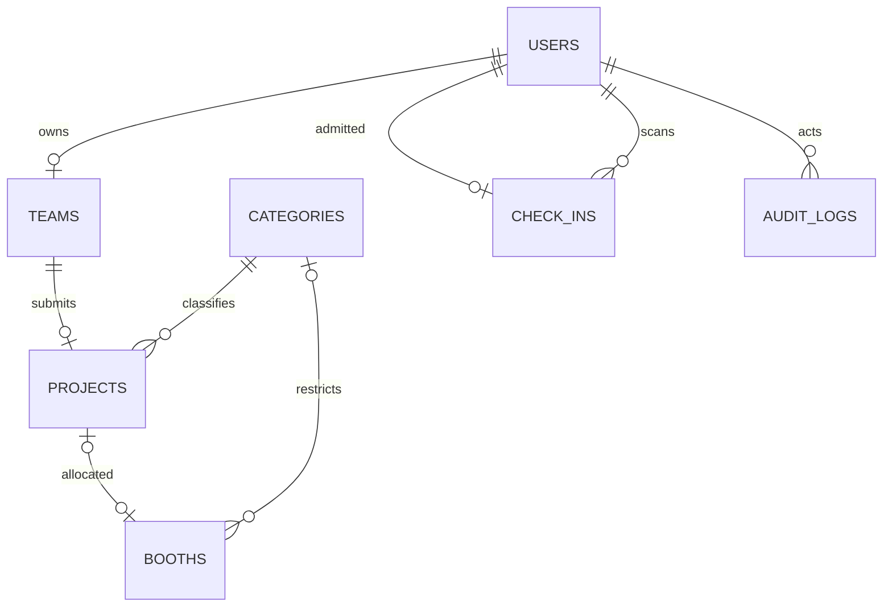
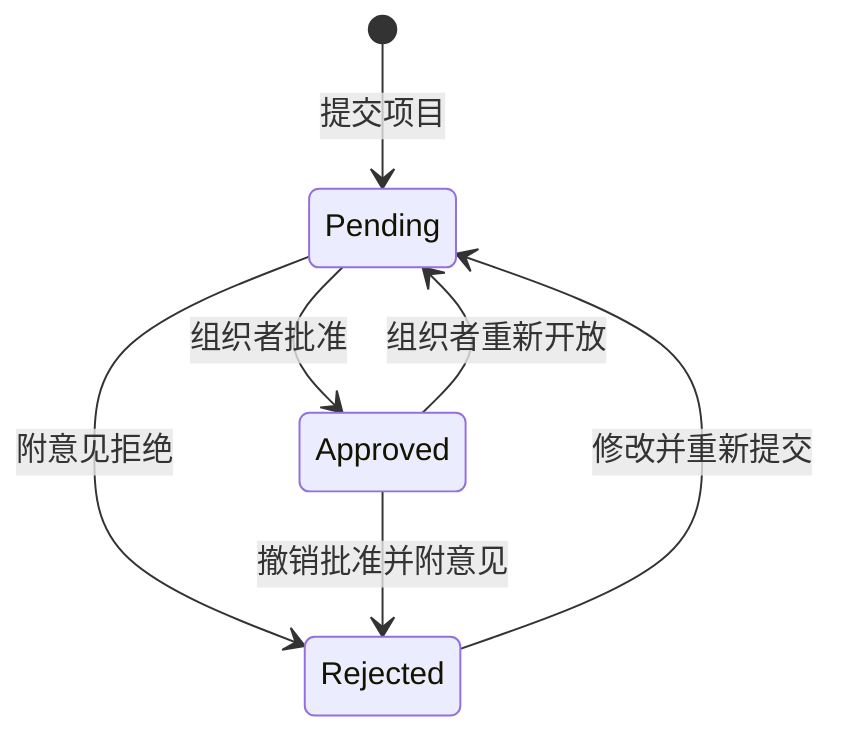
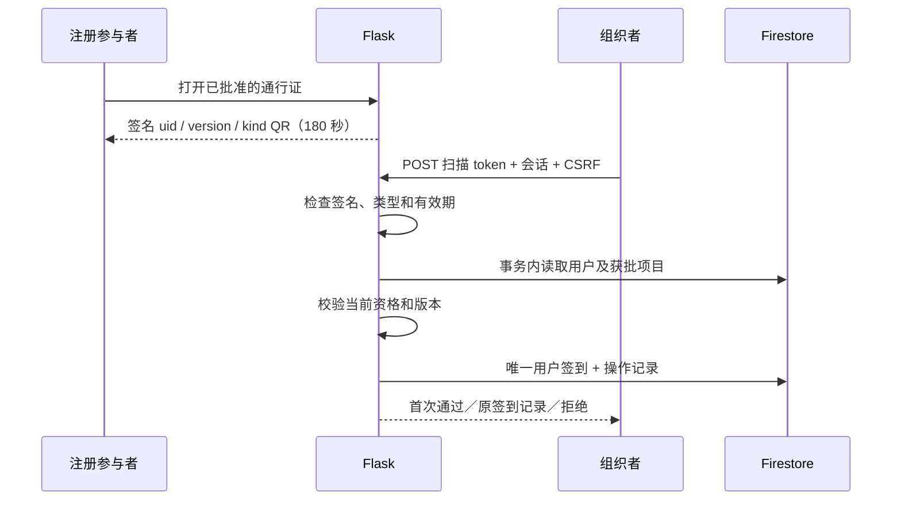

# 架构与业务流程

本系统实现单次 I-RICE 活动的报名、项目审核、展位分配和个人签到。Flask 渲染 Jinja 页面；轻量 JavaScript 处理导航、QR 刷新和相机扫码；仪表盘由用户手动刷新以获取最新状态。Bootstrap 与 html5-qrcode 使用仓库内的静态文件，网页运行不依赖第三方 CDN。

## 组件

| 模块 | 职责 |
| --- | --- |
| `irice/__init__.py` | 工厂、配置、CSRF、安全响应头、数据库健康检查 |
| `irice/auth.py` | 本系统邮箱／密码注册、登录、退出与角色检查 |
| `irice/participant.py` | 个人资料、团队、项目提交；海报入口明确停用 |
| `irice/admin.py` | 审核、展位分配、类别、报告和操作记录 |
| `irice/passes.py` | 入场资格、签名 QR、PDF 通行证、签到 |
| `irice/models.py` | 保留页面字段与关系接口的 Python 数据对象 |
| `irice/repository.py`、`irice/store.py` | 统一读写、事务、唯一值预留、Firestore 与显式本机测试后端 |
| `irice/cli.py` | 可重复初始化、受信任终端创建组织者、可选虚构演示数据 |

正式数据保存在 Firebase Cloud Firestore 默认数据库。使用官方 Python 服务器 SDK，通过服务账号 IAM 授权；浏览器客户端规则拒绝所有直接读写。登录没有改为 Firebase Authentication，不需要 Firebase Web SDK。

Vercel 的 `app.py` 暴露 Flask 应用，不启动 Docker／MySQL，也不在冷启动时自动填充数据。云端配置必须提供强随机、固定的 `SECRET_KEY` 和真实 Firebase 认证；不使用硬编码后备密钥或本机 SQLite 来掩盖连接失败。

## 数据关系

这是业务关系图，不是 SQL 外键。Firestore 集合保存用户、团队、项目、类别、展位、签到与操作记录，页面使用的整数 ID 和关系访问保持一致。只有参展者拥有团队，每个团队一个项目。名单成员不会自动产生账号。

预留的唯一值记录与业务写入放在同一个事务中，防止同邮箱注册或重复展位／类别名称。项目和展位双向保存分配引用，事务同时更新旧展位、新展位与项目；不会用“先检查再分别写入”来防止重复占位。每人签到使用与用户对应的确定 ID，重复请求返回首次记录。

全新 Firestore 数据库不导入旧 Aiven／MySQL 数据。默认类别和 20 个展位由明确执行的 `init-db` 补充，不会每次请求或冷启动都初始化。当前海报功能停用，不把上传文件写进 Vercel 临时目录，也不使用 Firebase Storage。

## 审核与展位分配

项目批准后可以等待展位分配。批准期间参展者不能修改项目／团队；重新开放或拒绝会释放展位并增加通行证版本号，使旧 QR 失效。每次签到还会读取最新批准状态。

业务修改通过 `repo.atomic` 执行。回调内重新读取相关文档，校验批准、类别与空闲状态，缓冲写入后整体提交；Firestore 的事务冲突重试负责并发竞争。批准、撤销、重新分配与签到不会依赖跨请求的缓存对象。

本机 `DATA_BACKEND=sqlite` 是显式的事务文档存储替身，只用于隔离测试和本机开发。Firestore Emulator 使用官方客户端执行数据库读写和事务；模拟器验证与真实云项目连接验证分别报告。

## 入场验证

PDF 入场证使用同一签名机制及独立 `download` 类型，有效期 24 小时；展位证书仅证明展位分配，不是入场凭据。任何 QR 的 GET 请求都不写签到。并发或重复扫描不会重复计数；撤销批准保留历史签到以便审计。

账号密码使用安全哈希；公开注册无法指定组织者角色。所有状态修改要求 POST 和 CSRF，后台请求检查服务器角色和所有权。没有公开的初始化／创建管理员路由；组织者由安全终端命令创建。

## 运行边界

时间以 UTC 保存，界面显示马来西亚时间。入场验证需要应用与数据库网络可用；不支持离线验票。团队名单仅作资料记录，每个入场的人需要独立批准账号。项目统计与人员签到分别计算。

本系统预约免费入场，不收款；没有原生手机 App、评分系统、密码找回邮件或海报文件服务。相机仍需在活动实际设备上验证。Firestore 和 Vercel 免费方案都有使用限制，每次打开或手动刷新列表／统计都会产生读取，仪表盘不自动轮询。在线通行证仍自动刷新有效期较短的 QR；测试优先使用模拟器。本机或模拟器测试通过不代表真实 Firebase、Vercel 部署或环境发布已经验证完成。
